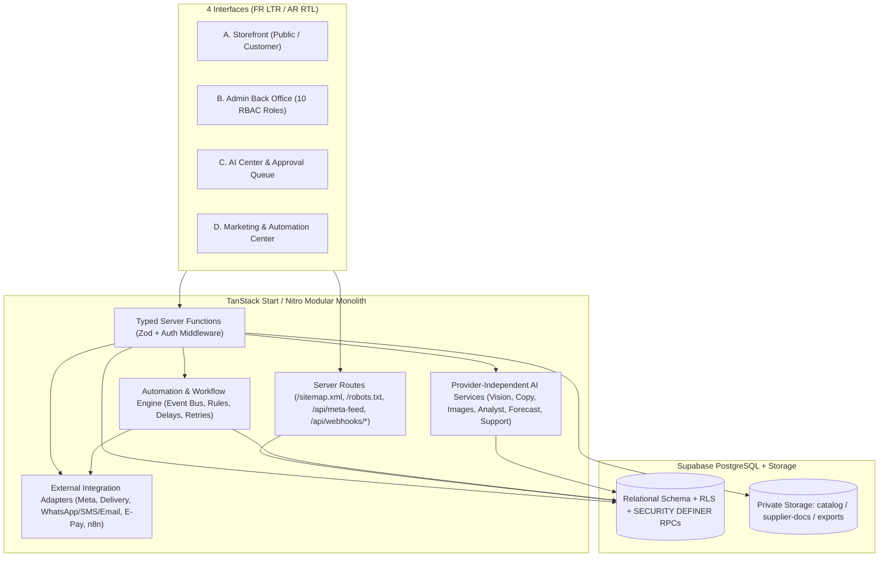

# SYSTEM ARCHITECTURE

## 1. Platform Stack (Modular Monolith on Existing `greenshop`)

Per PRD §17.1 (*"Use the following architecture unless a strong technical reason justifies an alternative"*) and [ADR-001](./DECISIONS.md#adr-001), we evolve the live `greenshop` Modular Monolith rather than rewriting from scratch:

- **Frontend & SSR:** TanStack Start + React 19 + TypeScript + Vite 8 + Tailwind CSS v4 + shadcn/ui + TanStack Query + Recharts.
- **Backend / API Layer:** TanStack Start Server Functions (`src/lib/*.functions.ts` + `src/lib/**/*.server.ts`) & Nitro server routes (`src/routes/api/*` for XML sitemap, robots.txt, Meta Catalog XML/CSV feed, webhooks, CAPI).
- **Database & Transactional Engine:** Supabase PostgreSQL (`msjlwxjsmijwnyywhknf`) with versioned SQL migrations (`supabase/migrations/0001..*.sql`), strict Row-Level Security (RLS), and `SECURITY DEFINER` transactional RPCs for all financial, stock, order, and landed-cost operations.
- **Storage:** Private Supabase Storage buckets (`catalog`, `documents`) with long-lived signed URLs.
- **AI Layer:** Provider-independent server modules (`src/lib/ai/*.server.ts`) powered by Vercel AI SDK (`ai` + `@ai-sdk/openai`) and configurable admin-managed keys (`ai_provider_settings`).
- **Deployment:** Vercel (auto-deploy from `main`) + Supabase Cloud.

---

## 2. High-Level System Diagram

---

## 3. Modular Monolith Boundaries (20 PRD Modules)

| # | Module | Server Code | Admin / Public Routes | Current Status |
|---|---|---|---|---|
| 1 | Auth & Sessions | `src/integrations/supabase/*`, `src/hooks/use-auth.tsx` | `/auth`, `/reset-password`, `/admin-setup` | Live |
| 2 | RBAC & Audit Logs | `src/lib/rbac.functions.ts` | `/admin/settings` (Roles, Permissions, Audit) | **Lot 1** (upgrading from 2→10 roles) |
| 3 | Products & Catalog | `src/lib/shop.functions.ts`, `src/lib/catalog.functions.ts` | `/`, `/shop`, `/product/$slug`, `/admin/products/*` | Live (+ Lot 1 & Lot 2 enhancements) |
| 4 | Categories & Brands | `src/components/admin/categories/*`, `src/lib/brands.functions.ts` | `/categories`, `/admin/categories` | Live (+ Brands/Collections in Lot 1) |
| 5 | Suppliers (China/Local) | `src/lib/erp/suppliers.functions.ts` | `/admin/suppliers` | **Lot 2** |
| 6 | Purchasing (POs) | `src/lib/erp/purchasing.functions.ts` | `/admin/purchases` | **Lot 2** |
| 7 | Imports & Landed Cost | `src/lib/erp/imports.functions.ts`, `src/lib/erp/landed-cost.ts` | `/admin/imports` | **Lot 2** |
| 8 | Inventory & Warehouse | `src/routes/_authenticated/admin/inventory.tsx` + RPCs | `/admin/inventory` | Live (+ Batches/Barcodes/Replenishment Lot 2) |
| 9 | Orders | `src/lib/orders.ts`, `src/lib/shop.functions.ts` | `/cart`, `/my-orders`, `/track-order`, `/admin/orders/*` | Live (+ Extended workflow & transitions Lot 3) |
| 10 | Payments (COD + E-Pay) | `src/lib/payments/*` | `/cart`, `/admin/finances`, `/admin/settings` | COD Live (+ Configurable E-Pay adapters Lot 3) |
| 11 | Delivery Adapters | `src/lib/delivery/*` | `/admin/delivery`, `/admin/orders/*` | **Lot 3** |
| 12 | Customers & CRM | `src/lib/crm.functions.ts` | `/my-account`, `/admin/customers` | Live (+ Segments, Timeline 360°, Consent Lot 3) |
| 13 | Marketing & Carts | `src/lib/marketing.functions.ts` | `/admin/marketing`, `/admin/social-studio` | Partial (+ Campaigns & Abandoned Carts Lot 4) |
| 14 | Meta Integration | `src/lib/meta/*`, `src/routes/api/meta-feed.ts` | `/admin/marketing/meta` | **Lot 4** (Pixel, CAPI, Catalog Feed, Ads) |
| 15 | AI Center & Approvals | `src/lib/ai/*`, `src/lib/ai-*.functions.ts` | `/admin/ai-center`, `/admin/ai-writer`, `/admin/social-studio` | Partial (Keys/Writer/Photo/Chat Live; Center/Analyst/Approvals **Lot 5**) |
| 16 | Automation Engine | `src/lib/automation/*` | `/admin/automations` | **Lot 6** |
| 17 | Finance & Accounting | `src/lib/finance.functions.ts` | `/admin/finances` | Live (+ Expenses, P&L, COD Reconciliation, Tax/Exports Lot 2/6) |
| 18 | BI & Analytics | `src/lib/analytics.functions.ts` | `/admin/dashboard`, `/admin/analytics` | Partial (+ Full BI Dashboard & PDF/CSV/Excel Lot 6) |
| 19 | Notifications | `src/lib/notifications/*` | In-app bell, `/admin/notifications` | **Lot 3** |
| 20 | Audit & System Settings | `src/routes/_authenticated/admin/settings.tsx` | `/admin/settings` | Live (+ Homepage CMS, Tax, Integrations Lot 1/3) |

---

## 4. Security & Data Access Rules

1. **Zero secrets in client bundle:** Only `VITE_SUPABASE_URL` and `VITE_SUPABASE_PUBLISHABLE_KEY` exist client-side. All OpenAI, Fal, Replicate, Meta, Delivery, WhatsApp, and Payment secrets live in server-only tables (`REVOKE ALL` from `anon`/`authenticated`) or Vercel server env vars.
2. **Defense-in-depth RBAC:** Every admin route checks permission via `useAuth().can(permission)` AND every PostgreSQL RLS policy / `SECURITY DEFINER` RPC verifies `public.has_permission('module.action')` server-side.
3. **Audit trail:** Sensitive writes (role changes, price changes, stock adjustments, PO approvals, refunds, cash collection, ad budget approvals, integration changes) append an immutable row to `public.audit_logs`.
4. **Human approval gate:** AI suggestions affecting prices, purchase orders, refunds, stock corrections, or ad campaigns insert into `public.ai_approvals` (`status = 'pending'`) and NEVER mutate live business tables until explicitly approved by an authorized human role.

---

## 5. External Integration Adapter Pattern

Every external integration (Delivery companies, Meta Graph/CAPI/Ads, Tunisian e-payment gateways, WhatsApp/SMS/Email, n8n webhooks) implements a uniform adapter contract stored in `integration_configs`:
- **Config & encrypted/locked credentials** (masked hints in UI).
- **Connection status & real test check** (`not_configured` | `connected` | `error`).
- **Manual + CSV fallback** for Tunisian delivery/payment providers without public APIs.
- **Persistent sync & error logs** (`integration_logs`) with retry tracking — never faking success.
