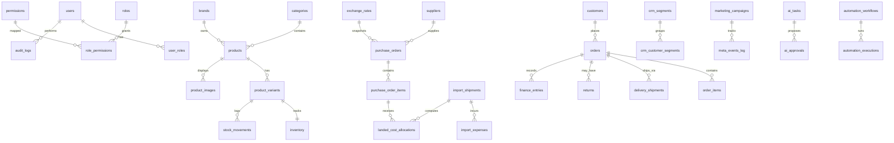

# DATABASE ARCHITECTURE & SCHEMA

- **Engine:** PostgreSQL 17 (Supabase project `msjlwxjsmijwnyywhknf`)
- **Migrations:** Immutable numbered SQL files in `supabase/migrations/` bundled into `supabase/bootstrap.sql` via `npm run db:bundle`.
- **Types:** Generated directly from the live schema into `src/integrations/supabase/types.ts`.
- **Monetary Precision:**
  - Tunisian Dinar sales/expenses/COGS: `numeric(12,3)` (exact millimes, never floating-point).
  - Foreign purchase unit costs & exchange rates: `numeric(14,4)` (CNY, USD, EUR).
  - Historical exchange rates & landed costs are stored as immutable snapshots per PO / shipment batch and never overwritten when current FX rates change.

---

## 1. Entity-Relationship Overview

---

## 2. Existing Schema Baseline (Migrations `0001` – `0022` — LIVE)

| Migration(s) | Core Tables & Functions |
|---|---|
| `0001` – `0005` | `profiles`, `user_roles`, `store_settings`, `categories`, `attributes`, `attribute_options`, `products`, `product_private`, `product_images`, `product_variants`, `variant_costs`, `inventory`, `stock_movements`, `orders`, `order_items`, `order_status_history`, `returns`, `return_items`, `finance_entries`, `promo_codes`, `reviews`, `customer_addresses`, `description_templates`, plus transactional RPCs (`create_order`, `transition_order`, `record_cod_payment`, `adjust_stock`, `track_order`, `get_variant_availability`). |
| `0006` – `0021` | Seed catalog (7 root categories, bilingual FR/AR products), storage policies, returns RLS recursion fix (`0021_fix_returns_rls_recursion.sql`). *(Note: seller columns from `0007`–`0015` are deprecated/unused under Single-Vendor rule — see ADR-002).* |
| `0022` | `ai_provider_settings` (admin-only locked secrets table + `admin_get_ai_settings_status`, `admin_save_ai_settings`, `staff_get_ai_runtime_config`, `get_assistant_public_status`). |

---

## 3. Planned Migrations (`0023` – `0030`)

| Migration | Lot | New Tables / Columns / RPCs |
|---|---|---|
| **`0023_rbac_audit_and_storefront_plus.sql`** | **Lot 1** | `rbac_roles` (10 seeded roles), `rbac_permissions` (module.action catalog), `rbac_role_permissions`, `user_rbac_roles`, `audit_logs`, `has_permission(text)` SQL helper; `brands`, `collections`, `collection_products`, `wishlists`, `newsletter_subscribers`, `homepage_sections` (configurable CMS blocks); extra product fields (`barcode`, `weight_grams`, `dimensions_cm`, `seo_title_fr/ar`, `seo_desc_fr/ar`, `video_url`, `landed_cost`). |
| **`0024_erp_suppliers_purchases_imports.sql`** | **Lot 2** | `warehouses` (default central warehouse), `currencies` & `exchange_rates` (historical FX), `suppliers`, `supplier_documents`, `supplier_payments`, `purchase_orders`, `purchase_order_items`, `import_shipments`, `import_shipment_pos`, `import_expenses`, `landed_cost_allocations`, `stock_batches`, `physical_inventory_counts`; transactional RPCs (`receive_purchase_order`, `calculate_shipment_landed_cost`, `commit_physical_count`). |
| **`0025_delivery_crm_notifications.sql`** | **Lot 3** | `delivery_providers` (configurable adapters), `delivery_shipments`, `cod_reconciliation_batches`, `payment_providers`; `crm_segments`, `crm_customer_segments`, `customer_notes`, `customer_consents`, `loyalty_points_ledger`; `notification_templates` (FR/AR), `notifications` (in-app & channel log). |
| **`0026_marketing_meta_abandoned_carts.sql`** | **Lot 4** | `integration_configs`, `integration_logs`, `meta_catalog_sync_logs`, `meta_events_log` (Pixel/CAPI dedup by `event_id`), `meta_ad_snapshots`, `marketing_campaigns`, `abandoned_carts` (session/customer recovery + status). |
| **`0027_ai_center_and_approvals.sql`** | **Lot 5** | `ai_usage_logs` (provider, model, feature, tokens, estimated cost), `ai_recommendations` (demand forecast, pricing, dead stock), `ai_approvals` (human-in-the-loop queue with `pending`/`approved`/`rejected`/`executed`, payload diff, reviewer & timestamp), RPC `resolve_ai_approval`. |
| **`0028_automation_engine_and_finance_pnl.sql`** | **Lot 6** | `automation_workflows` (trigger, conditions JSONB, steps JSONB, is_active), `automation_executions`, `automation_step_logs`; `operating_expenses` (rent, salaries, ads, shipping, misc), `tax_settings` (configurable Tunisian VAT/timbre fiscal), `scheduled_reports`. |
